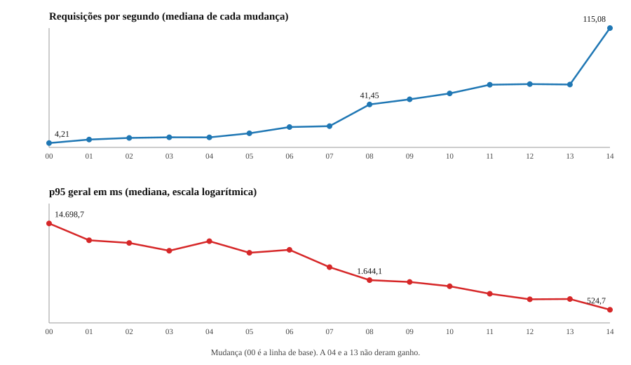
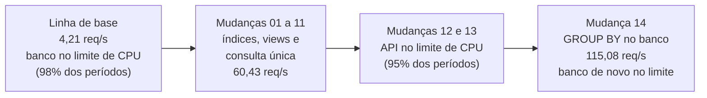

# API lenta por falta de índices e consultas ineficientes: 14 mudanças com índice, view e consulta no banco levaram a vazão de 4,21 a 115,08 req/s

## 1. Resumo

A API de uma loja fictícia atendia 4,21 requisições por segundo, com p95 geral (o tempo abaixo do qual ficam 95% das respostas) de 14.698,7 ms, porque as consultas liam tabelas inteiras sem índice, faziam uma consulta por item (N+1) e abriam uma conexão por consulta. Foram 14 mudanças, cada uma medida pelo menos três vezes, nos mesmos limites de CPU e memória. Com índices, duas views materializadas e consultas reescritas, a vazão chegou a 115,08 req/s e o p95 geral a 524,7 ms. Duas mudanças não deram ganho, e as views só servem porque a API só lê.

## 2. Contexto e diagnóstico

A aplicação é a API de uma loja fictícia (Node.js e PostgreSQL 16, com limite de 0,5 CPU na API e 1 CPU no banco). Na linha de base ela atendia 4,21 requisições por segundo, com p95 geral de 14.698,7 ms (`resultados/20261114-*-00-linha-de-base`). O banco ficou no limite de CPU em quase todos os períodos (`diagnostico/00`).

O sinal veio dos planos de execução, que `EXPLAIN (ANALYZE, BUFFERS)` mostra com o tempo real de cada etapa (`diagnostico/07`). Nas consultas analisadas o plano era um `Seq Scan` (`Parallel Seq Scan` nas tabelas grandes): leitura sequencial da tabela inteira, no heap (onde o PostgreSQL guarda as linhas). Numa consulta de itens, cada um dos 3 processos em paralelo descartou 499.999 linhas para achar 1. Nesses casos, quanto mais raro o filtro, mais um índice se paga.

Hipótese por problema:

- **`/clientes/:id/pedidos`:** N+1 (uma consulta para a lista de pedidos e outra por pedido e por item), e cada leitura de itens percorre cerca de 1,5 milhão de linhas, sem índice em `pedido_id`.
- **`/clientes?email=`:** falta de índice, e o banco percorre as 100.000 linhas para achar 1. Um índice comum em `email` não serviria, porque a consulta compara `lower(email)`, o e-mail em minúsculas.
- **`/relatorios/top-produtos`:** o tempo vai nas junções entre tabelas e no agrupamento, e um índice tende a não resolver, porque a consulta usa a maior parte delas.
- **`/pedidos?status=`:** ordenação em disco (`external merge`) de cerca de 300 mil linhas para devolver 20, mais uma consulta para a contagem.
- **`/relatorios/vendas-por-dia`:** o filtro `criado_em::date` impede um índice, e a soma por dia era feita no Node (`diagnostico/28`).
- **`/produtos/busca`:** `Seq Scan` nas 20.000 linhas, porque `ILIKE '%termo%'` começa com `%` e um índice comum não o atende (`diagnostico/34`).
- **Conexão a cada consulta:** pesa na abertura, na rede e na CPU. 100 requisições abriram 101 sessões (`diagnostico/06`).

## 3. Estado da arte

**Índices e a escolha do planejador.** O planejador do PostgreSQL escolhe o caminho de menor custo estimado, a mesma ideia do System R, em Selinger et al. [1]. Ele estima 1,0 para uma página lida em sequência e 4,0 para uma lida fora de ordem [2], e o index scan fica mais barato quanto mais a ordem física das linhas acompanha a da coluna [3]. Um índice com `INCLUDE` guarda colunas extras, e o index-only scan as devolve "without having to visit the index's table" [12], mas elas "bloat the size of the index" [13]. **Minha leitura:** assintoticamente um índice, O(log N + k), vence a leitura linear seguida de ordenação, O(N + k log k), com k as linhas devolvidas, mas quanto maior o k, mais saltos aleatórios no heap, e a ordem física se desfaz com o tempo, porque o `CLUSTER` não mantém a ordem das linhas novas [4] e o `VACUUM` só marca o espaço para reutilização [5].

**Dado derivado.** Uma view materializada guarda o resultado da consulta como uma tabela, e "the data is not always current; yet sometimes current data is not needed" [6]. O `REFRESH MATERIALIZED VIEW CONCURRENTLY` atualiza sem bloquear leituras e exige um índice `UNIQUE` [7].

**Reescrever a consulta e as conexões.** O N+1 (uma consulta para a lista e outra por item) cai de 11 consultas para 2 com carregamento antecipado, nos Rails Guides [8]. Segundo o node-postgres, uma conexão nova exige um handshake de 20 a 30 ms, e ele recomenda um pool de conexões reaproveitadas [9] (afirmação sem método). Num cache externo, cada falha de leitura custa três idas (cache, banco e escrita no cache) [14], texto de um fornecedor.

**Medir com rigor.** Amdahl argumentou que o esforço em processamento paralelo é desperdiçado se a parte sequencial não melhora na mesma medida [10]. **Minha leitura:** apliquei a ideia à CPU por rota: pela conta de `diagnostico/28`, a soma no JavaScript de `vendas-por-dia` era cerca de 84,8% da CPU da API, e por isso mexer no log não ajudou e agrupar no banco ajudou. Georges et al. mostram, para Java, que o tempo varia entre execuções, e defendem intervalos de confiança [11]. Comparei a mediana de três execuções e a sobreposição das faixas, o que é mais fraco que o método deles.

## 4. Alternativas consideradas

A, B e C foram aplicadas e medidas, e a D não foi testada, então as células dela são estimativas. Cada linha traz um exemplo medido, em p95 da rota ou, na C, em CPU da API por requisição. O esforço inclui recriar o banco, porque todo `.sql` novo só roda assim.

| Alternativa | Custo | Desempenho | Risco | Esforço |
| --- | --- | --- | --- | --- |
| A. Índices (composto, na expressão, cobrindo) | espaço e memória do banco (o índice `pedidos(cliente_id, ...)` da 06 ocupa 19 MB contra 163 MB da tabela, `diagnostico/11`) | maior ganho onde o filtro é raro: p95 de `pedidos-do-cliente` de 3.673,6 para 170,9 ms (mudança 06) | o banco chegou ao limite de memória na 07 (causa não isolada) | baixo: um `.sql`, com o banco recriado |
| B. Dado derivado (view materializada) | espaço da view e, em produção, o `REFRESH` | p95 de `top-produtos` de 32.719,5 para 415,3 ms (08) | dado desatualizado, que aqui não aparece porque a API só lê e nenhuma view tem `REFRESH` | médio: um `.sql`, a rota que lê a view e o banco recriado |
| C. Reescrever a consulta (JOIN no lugar do N+1, `GROUP BY` no banco) | nenhum serviço nem estrutura nova | p95 de `pedidos-do-cliente` de 8.513,6 para 2.773,3 ms (03) e CPU da API em `vendas-por-dia` de 108,46 para 1,98 ms por requisição (14, `diagnostico/28` e `31`, uma execução sem carga) | a resposta pode mudar, e exigiu comparação além do contrato | médio: código e teste de equivalência |
| D. Cache externo (estimativa) | um serviço a mais, com CPU e memória | não testada | em produção os dados variam, então não há garantia de achar o dado no cache, e ele mostraria dado antigo | alto |

## 5. Solução escolhida e por quê

Pelo diagnóstico, nenhuma abordagem sozinha atendia todas as rotas, e escolhi combiná-las por rota. Onde o filtro é raro (cliente, e-mail, pedidos de um cliente), usei índices: quanto menos linhas o filtro devolve, mais um índice compensa. Onde a consulta usa quase toda a tabela (`top-produtos`), índice não resolve, porque obriga a saltos aleatórios entre páginas, que o PostgreSQL estima em 4 vezes o custo de uma leitura sequencial [2]. Ali usei uma view com o resultado pronto. Onde o problema era o número de idas ao banco ou a soma feita no JavaScript, reescrevi a consulta (JOIN no lugar do N+1, `GROUP BY` no banco).

Descartei o cache externo por dois motivos. Um cache só acerta quando os mesmos dados se repetem, o que em produção não é garantido, e ele também mostra dado antigo, problema que as views só evitam aqui porque a API só lê [14]. E um serviço a mais custaria a mais, fora dos limites originais, enquanto a view já elimina o trabalho repetido.

## 6. Experimento e resultado

Medianas das execuções válidas (três, e cinco na 07), com 20 usuários virtuais, 60 s e semente 42, contra a mudança anterior, nos limites originais. Memória: média de banco / API em MiB. CPU: leitura do cgroup, em segundos por execução, só nas mudanças 12 a 14, porque o `docker stats` daqui não é confiável (`diagnostico/33`). Detalhes: [experimentos.md](../experimentos.md).

| Mudança | Hipótese | p95 geral antes → depois (ms) | req/s antes → depois | CPU/memória | Pastas | Conclusão |
| --- | --- | --- | --- | --- | --- | --- |
| 01 índice em `itens_pedido` | o índice evita ler a tabela inteira a cada consulta de itens, e `/clientes/:id/pedidos` deve cair | 14.698,7 → 7.672,0 | 4,21 → 7,59 | 296,5 → 331,8 / 54,3 → 68,9 | `20261118-*-01-indice-itens-pedido` | o p95 geral caiu pela metade, o N+1 continua e `top-produtos` piorou |
| 02 pool, `max` 10 | o pool evita abrir uma conexão a cada consulta | 7.672,0 → 6.918,9 | 7,59 → 9,12 | 331,8 → 274,7 / 68,9 → 36,7 | `20261118-18*-02-pool-de-conexoes` | o geral melhorou e três rotas pioraram (`cliente`, `busca-produtos` e `pedidos-do-cliente`) |
| 03 `LEFT JOIN` | uma consulta só elimina as idas ao banco do N+1, e as outras rotas só mudam por efeito indireto | 6.918,9 → 5.123,3 | 9,12 → 9,75 | 274,7 → 272,3 / 36,7 → 34,5 | `20261118-20*-03-join-pedidos-do-cliente` | o p95 da rota caiu de 8.513,6 para 2.773,3 ms e as leves pioraram |
| 04 pool, `max` 20 | mais conexões tiram as rotas leves da fila | 5.123,3 → 7.399,6 | 9,75 → 9,66 | 272,3 → 340,3 / 34,5 → 41,9 | `20261118-20*-04-pool-max-20` | sem ganho, o geral piorou |
| 05 índice em `pedidos(status, criado_em, id)` | o índice evita a ordenação em disco | 7.399,6 → 4.738,1 | 9,66 → 13,64 | 340,3 → 357,6 / 41,9 → 48,2 | `20261118-21*-05-indice-pedidos-status` | o p95 da rota caiu de 9.358,0 para 3.259,3 ms |
| 06 índice em `pedidos(cliente_id, ...)` | o índice evita ler os 500 mil pedidos | 4.738,1 → 5.303,5 | 13,64 → 19,6 | 357,6 → 415,3 / 48,2 → 63,3 | `20261119-*-06-indice-pedidos-cliente` | o p95 da rota caiu de 3.673,6 para 170,9 ms, e o geral subiu, com faixas sobrepostas |
| 07 filtro por intervalo e índice em `criado_em` | o filtro na coluna sem conversão (`criado_em::date`) permite usar o índice, e as duas partes vêm juntas porque uma depende da outra | 5.303,5 → 2.718,4 | 19,6 → 20,52 | 415,3 → 431,8 / 63,3 → 46,0 | `20261119-*-07-indice-pedidos-criado-em` | o p95 da rota caiu pela metade e o banco ficou instável na memória |
| 08 view de `top-produtos` | somar uma vez, na criação do banco | 2.718,4 → 1.644,1 | 20,52 → 41,45 | 431,8 → 275,6 / 46,0 → 49,2 | `20261119-19*-08-top-produtos-view` | o p95 da rota caiu de 32.719,5 para 415,3 ms |
| 09 view do total de `/pedidos` | ler o total pronto evita o `count` | 1.644,1 → 1.532,5 | 41,45 → 46,39 | 275,6 → 236,4 / 49,2 → 51,5 | `20261119-20*-09-pedidos-total-view` | a mediana da rota caiu e o p95 ficou na mesma faixa |
| 10 índice cobrindo | o índice com `INCLUDE` dispensa ler a tabela, e o `SELECT` só de colunas do índice faz parte da mudança | 1.532,5 → 1.298,8 | 46,39 → 52,09 | 236,4 → 215,1 / 51,5 → 48,2 | `20261119-22*-10-pedidos-indice-cobrindo` | o p95 da rota caiu de 2.026,7 para 683,4 ms |
| 11 índice em `lower(email)` | o índice na expressão evita varrer `clientes` | 1.298,8 → 972,5 | 52,09 → 60,43 | 215,1 → 213,1 / 48,2 → 44,3 | `20261119-22*-11-clientes-indice-email` | o p95 da rota caiu de 1.616,0 para 709,6 ms |
| 12 pool, `max` 10 de novo | menos consultas simultâneas dividem menos a CPU do banco | 972,5 → 786,3 | 60,43 → 61,03 | 213,1 → 184,2 / 44,3 → 40,1. CPU: API 95% a 96% dos períodos no limite (`diagnostico/26`) | `20261120-102*-12-pool-max-10` | refutada em parte pelo critério do commit: o p95 geral caiu, mas `busca-produtos` variou mais que `cliente`. Depois a leitura do cgroup mostrou a API no limite de CPU |
| 13 log sem o corpo | não serializar o corpo poupa CPU da API | 786,3 → 793,3 | 61,03 → 60,64 | 184,2 → 183,7 / 40,1 → 40,3. CPU: API 37,6 a 38,1 s (`diagnostico/27`) | `20261120-103*-13-log-sem-corpo` | sem ganho, o CPU da API ficou igual (37,6 a 38,1 s) |
| 14 `vendas-por-dia` agrupa no banco | agrupar no banco poupa a CPU da API | 793,3 → 524,7 | 60,64 → 115,08 | 183,7 → 201,9 / 40,3 → 27,9. CPU: API 37,6 a 38,1 → 6,7 a 7,8 s, banco 40,3 a 40,5 → 75,7 a 75,9 s (`diagnostico/27` e `29`) | `20261120-*-14-vendas-por-dia-sql` | a vazão quase dobrou, a API saiu do teto e o banco voltou a ser o gargalo |

O gráfico mostra a mediana de cada mudança, da linha de base à 14.

A mudança que mais surpreendeu foi a view materializada da 08: o p95 de `top-produtos` caiu de 32.719,5 para 415,3 ms e o req/s dobrou, porque a soma dos itens deixou de ser refeita a cada requisição. A outra grande alta foi a 14: a API saiu do limite de CPU e o gargalo voltou para o banco. Com os mesmos limites, e portanto o mesmo custo provisionado, a aplicação atende 115,08 req/s contra 4,21, e a memória média caiu de 296,5 para 201,9 MiB no banco e de 54,3 para 27,9 MiB na API. Reduzir os limites ficou na ficha 5 de `proximos-testes.md`.

O limite de CPU mudou de lugar ao longo das mudanças:

Duas mudanças não deram ganho. A 04 (`max` 20 no pool) piorou o p95 geral, de 5.123,3 para 7.399,6 ms, e a 13 (log sem o corpo da resposta) deixou a CPU da API igual.

## 7. Limites e testes futuros

O que pode falhar e o que não foi verificado:

- **Dado derivado sem atualização.** As duas views não têm `REFRESH` e só servem porque a API só lê. Com pedidos novos, elas mentiriam.
- **Carga com poucos valores.** O teste usa 12 termos de busca, janelas de 7 dias e `limite=10`, então os ganhos valem para essa distribuição.
- **Memória do banco.** Na 07 o banco chegou ao limite de 512 MiB e usou swap, sem causa isolada (`diagnostico/13`). Descartei execuções na 02 e na 06 por swap e na 07 por erro ou por processo encerrado por falta de memória (na 07 todas as medidas usaram swap), e as pastas descartadas não foram mantidas (`experimentos.md`, `diagnostico/12` e `13`).
- **Custo dos índices.** Não foi medido nas escritas, porque a API só lê.
- **Não testado.** O cache externo e a fila do pool de conexões (causa provável da piora de outras rotas nas mudanças 02 e 03) não foram medidos.

A conclusão de que combinar abordagens por rota é melhor cairia se uma única abordagem, com a mesma carga, chegasse a um p95 geral igual ou menor que o das 14 mudanças, se, com escritas na carga, o custo de atualizar views e índices anulasse o ganho, ou se, com outra semente ou janelas de 31 dias, a ordem dos ganhos mudasse.

Em [proximos-testes.md](../proximos-testes.md) ficaram seis fichas, entre elas um índice trigrama para a busca e uma view por dia para `vendas-por-dia`.

## 8. Referências

1. Selinger, P. G., Astrahan, M. M., Chamberlin, D. D., Lorie, R. A. e Price, T. G. Access Path Selection in a Relational Database Management System. SIGMOD, 1979. https://courses.cs.washington.edu/courses/cse444/25wi/papers/selinger79.pdf. Acesso em 2026-11-20.
2. PostgreSQL Global Development Group. PostgreSQL 16 Documentation, 20.7 Query Planning. https://www.postgresql.org/docs/16/runtime-config-query.html. Acesso em 2026-11-20.
3. PostgreSQL Global Development Group. PostgreSQL 16 Documentation, 54.27 pg_stats. https://www.postgresql.org/docs/16/view-pg-stats.html. Acesso em 2026-11-20.
4. PostgreSQL Global Development Group. PostgreSQL 16 Documentation, CLUSTER. https://www.postgresql.org/docs/16/sql-cluster.html. Acesso em 2026-11-20.
5. PostgreSQL Global Development Group. PostgreSQL 16 Documentation, 25.1 Routine Vacuuming. https://www.postgresql.org/docs/16/routine-vacuuming.html. Acesso em 2026-11-20.
6. PostgreSQL Global Development Group. PostgreSQL 16 Documentation, 41.3 Materialized Views. https://www.postgresql.org/docs/16/rules-materializedviews.html. Acesso em 2026-11-20.
7. PostgreSQL Global Development Group. PostgreSQL 16 Documentation, REFRESH MATERIALIZED VIEW. https://www.postgresql.org/docs/16/sql-refreshmaterializedview.html. Acesso em 2026-11-20.
8. Ruby on Rails. Active Record Query Interface, 16.1 N + 1 Queries Problem. https://guides.rubyonrails.org/active_record_querying.html. Acesso em 2026-11-20.
9. node-postgres. Pooling. https://node-postgres.com/features/pooling. Acesso em 2026-11-20.
10. Amdahl, G. M. Validity of the Single Processor Approach to Achieving Large Scale Computing Capabilities. AFIPS Conference Proceedings, vol. 30, 1967, pp. 483-485. https://www3.cs.stonybrook.edu/~rezaul/Spring-2019/CSE613/reading/Amdahl-1967.pdf. Acesso em 2026-11-20.
11. Georges, A., Buytaert, D. e Eeckhout, L. Statistically Rigorous Java Performance Evaluation. OOPSLA, 2007. https://dri.es/files/oopsla07-georges.pdf. Acesso em 2026-11-20.
12. PostgreSQL Global Development Group. PostgreSQL 16 Documentation, 11.9 Index-Only Scans and Covering Indexes. https://www.postgresql.org/docs/16/indexes-index-only-scans.html. Acesso em 2026-11-20.
13. PostgreSQL Global Development Group. PostgreSQL 16 Documentation, CREATE INDEX. https://www.postgresql.org/docs/16/sql-createindex.html. Acesso em 2026-11-20.
14. Amazon Web Services. Amazon ElastiCache, Caching strategies for Memcached. https://docs.aws.amazon.com/AmazonElastiCache/latest/dg/Strategies.html. Acesso em 2026-11-20.

## 9. Uso de IA

Usei um agente de IA para executar as medições e os diagnósticos (`EXPLAIN` e leituras de cgroup), conferir o contrato, gerar o gráfico, buscar fontes para consulta e respaldo e ajudar na redação, a partir das minhas respostas, que revisei seção por seção. Li cada fonte citada, e agentes revisaram números e citações, para evitar erro humano. O diagnóstico, as hipóteses, a escolha das mudanças e o SQL e as refatorações centrais foram meus, e os números vêm de `resultados/`, gerados pelo `medir.sh`, e de `diagnostico/`.
